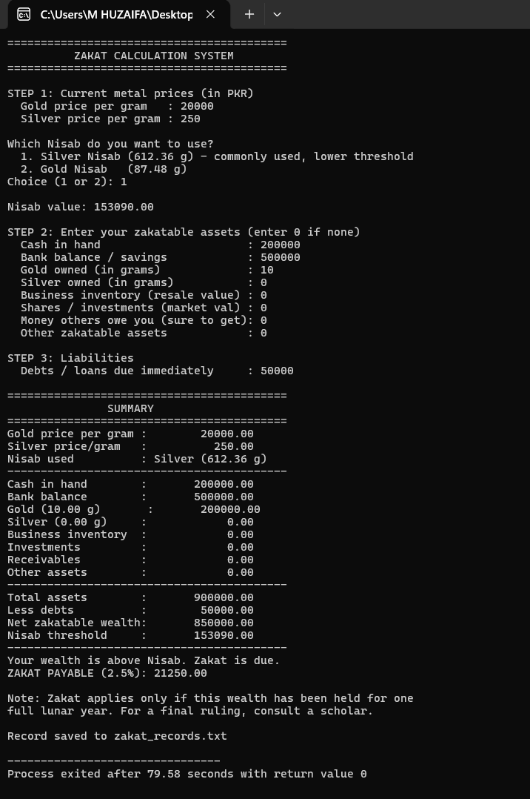
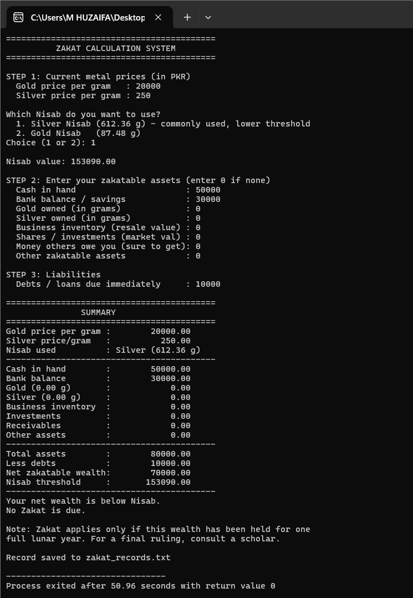
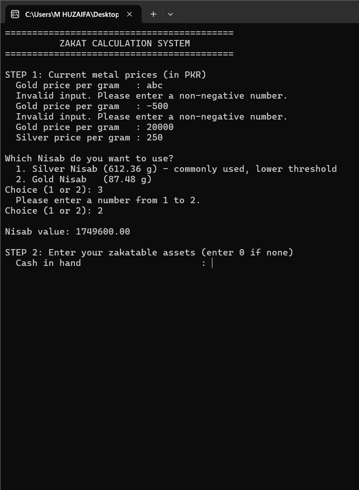
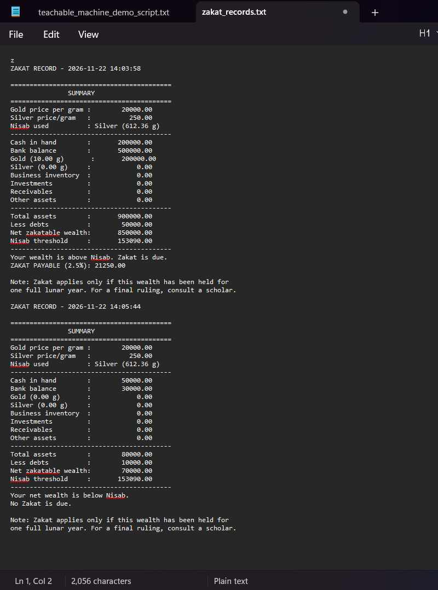

# Zakat Calculation System

## Section A: Project Introduction

The Zakat Calculation System is a command-line program written in C that helps a user work out whether Zakat is due on their wealth and how much to pay. Its core objective is to compare a user's net zakatable wealth against the Nisab threshold (silver or gold, using the day's price per gram) and calculate 2.5% of that wealth when it qualifies. The main features implemented in C are validated numeric input using `fgets` and `strtod`, a menu to choose between Silver and Gold Nisab, support for eight asset categories and a debt deduction, a formatted on-screen summary produced by a reusable `print_report` function, and file handling that appends a timestamped record of every calculation to `zakat_records.txt`.

---

## Section B: Features & Test Cases (Execution Scenarios)

- **Case 1: Zakat Calculation Above Nisab (Silver Nisab)**
  - **Description:** Tests the main workflow. The user enters metal prices, selects Silver Nisab, enters assets and debts, and the program calculates net wealth. Because the net wealth is above Nisab, Zakat of 2.5% is calculated.
  - **Inputs:**
    - Gold price per gram: `20000`
    - Silver price per gram: `250`
    - Nisab choice: `1`
    - Cash: `200000`, Bank: `500000`, Gold: `10` g, Silver: `0` g
    - Business inventory, investments, receivables, other assets: `0`
    - Debts: `50000`
  - **Expected Output:**
    ```
    Nisab value: 153090.00
    ...
    Total assets        :       900000.00
    Less debts          :        50000.00
    Net zakatable wealth:       850000.00
    Nisab threshold     :       153090.00
    ------------------------------------------
    Your wealth is above Nisab. Zakat is due.
    ZAKAT PAYABLE (2.5%): 21250.00
    ```
  - **Screenshot:** 

- **Case 2: Wealth Below Nisab (No Zakat Due)**
  - **Description:** Tests the condition where the user's net wealth is lower than the Nisab threshold, so no Zakat is payable.
  - **Inputs:**
    - Gold price per gram: `20000`
    - Silver price per gram: `250`
    - Nisab choice: `1`
    - Cash: `50000`, Bank: `30000`
    - All other assets: `0`
    - Debts: `10000`
  - **Expected Output:**
    ```
    Net zakatable wealth:        70000.00
    Nisab threshold     :       153090.00
    ------------------------------------------
    Your net wealth is below Nisab.
    No Zakat is due.
    ```
  - **Screenshot:** 

- **Case 3: Gold Nisab Selection**
  - **Description:** Tests that choosing option 2 switches the threshold to the Gold Nisab (87.48 g). Using the same assets as Case 1 shows how the choice of Nisab changes the result.
  - **Inputs:**
    - Gold price per gram: `20000`
    - Silver price per gram: `250`
    - Nisab choice: `2`
    - Same assets and debts as Case 1
  - **Expected Output:**
    ```
    Nisab value: 1749600.00
    ...
    Net zakatable wealth:       850000.00
    Nisab threshold     :      1749600.00
    ------------------------------------------
    Your net wealth is below Nisab.
    No Zakat is due.
    ```
  - **Screenshot:** 

- **Case 4: Invalid Input & Error Handling**
  - **Description:** Tests how the program handles unexpected input such as letters, negative numbers, decimals or out-of-range values in the menu. The program rejects the input and asks again instead of crashing or accepting bad data.
  - **Inputs:**
    - Gold price per gram: `abc`, then `-500`, then `20000`
    - Nisab choice: `3`, then `1.5`, then `1`
  - **Expected Output:**
    ```
      Gold price per gram   : abc
      Invalid input. Please enter a non-negative number.
      Gold price per gram   : -500
      Invalid input. Please enter a non-negative number.
      Gold price per gram   : 20000
    ...
    Choice (1 or 2): 3
      Please enter a number from 1 to 2.
    Choice (1 or 2): 1.5
      Please enter a number from 1 to 2.
    Choice (1 or 2): 1
    ```
    The program only continues once a valid value is entered.
  - **Screenshot:** 

- **Case 5: Saving Records to File**
  - **Description:** Tests file handling. After each calculation, the full report is appended with a date and time to `zakat_records.txt`, so records from earlier runs are kept. Running the program twice should leave two records in the file.
  - **Inputs:**
    - Run the program once with the inputs of Case 1, then run it again with the inputs of Case 2.
  - **Expected Output:**
    - On screen: `Record saved to zakat_records.txt`
    - In `zakat_records.txt`, two records, each starting with:
      ```
      ZAKAT RECORD - 2026-11-21 14:30:05
      ==========================================
                     SUMMARY
      ==========================================
      ```
      followed by the full summary for that run.
  - **Screenshot:** 
